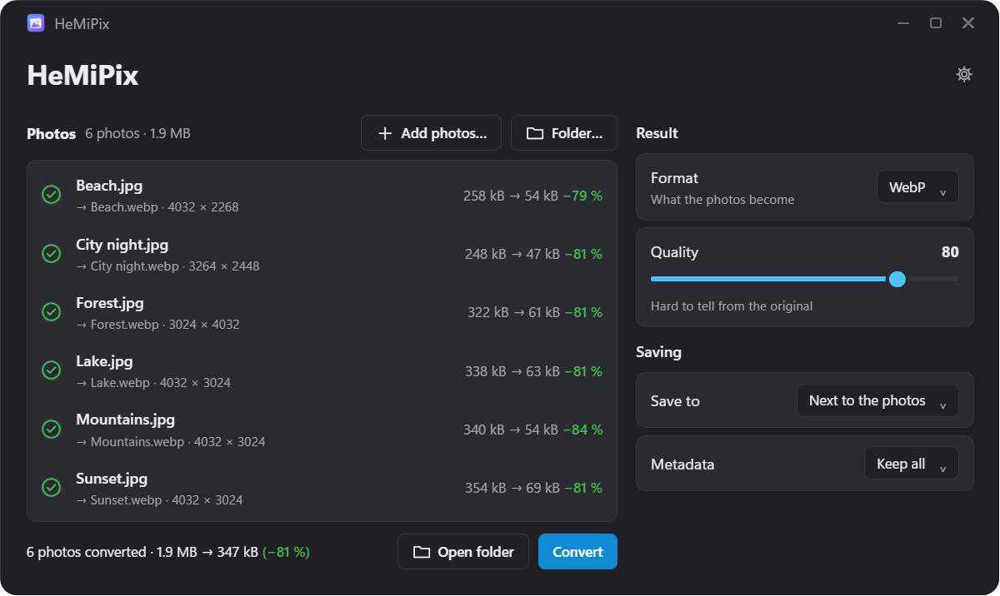

#  HeMiPix

[](https://github.com/Hemal1k/HeMiPix/releases/latest) [](https://github.com/Hemal1k/HeMiPix/releases) [](LICENSE) 

Photos from an iPhone are HEIC – and many programs and websites still want **JPG**. HeMiPix converts photos between
**HEIC, JPG, PNG, WebP and TIFF** – **whole folders at once** –, can make them **smaller** and lets you **crop** each
photo with a frame you drag. In the look of Windows 11, and it never goes online.

**[Download](https://github.com/Hemal1k/HeMiPix/releases/latest)** · [Project page](https://hemal1k.github.io/hemipix.html) · [Report a problem](https://github.com/Hemal1k/HeMiPix/issues)



> The downloads are not code-signed, so Windows SmartScreen may warn the first time (More info → Run anyway). Each release has `SHA256SUMS.txt` to check them.

## Download

| File | For |
|---|---|
| `HeMiPix-Setup.exe` | The installer – just for you (no administrator) or for all users (Program Files), x64 or ARM64, with a Start menu entry, an optional desktop shortcut and an uninstaller. |
| `HeMiPix-Portable.zip` | Just the program for x64; run it from any folder. |
| `HeMiPix-Portable-arm64.zip` | The same for Windows on ARM. |

Windows 10 / 11, x64 and ARM64. HEIC is read by Windows itself: it needs the free **HEIF Image Extensions** and **HEVC Video
Extensions** from the Microsoft Store (most PCs have them; the installer – and the portable version itself – offers to install them when they are missing).

## Features

- **Many photos at once**: drop photos or whole folders (with subfolders) onto the window, or add them with the buttons;
  they are converted on all cores of the processor, with the progress and the saved space shown.
- **Formats**: reads HEIC / HEIF, AVIF, WebP, PNG, JPG, TIFF and BMP; writes **JPG**, **PNG**, **WebP** or **TIFF**.
  Transparency stays in PNG, WebP and TIFF (JPG gets white instead).
- **Smaller**: the quality of JPG and WebP 30–100, with a hint what the value means; PNG and TIFF are lossless.
- **Crop** any photo of the list: a preview with a frame to drag by its corners and edges or to move, free or in a
  fixed shape (1:1, 4:3, 3:2, 16:9 – turned for upright photos), the size in pixels shown; ‹ › go through the photos.
- **Upright**: photos come out turned the right way, also JPGs with an Exif orientation.
- **Metadata** (Exif: date taken, camera, location) is kept in JPG, PNG and WebP – or kept **without the location**, or removed (one choice);
  the colour profile (Display P3 of iPhones) stays too; the file date of the original stays, so the photos sort as
  before.
- **Where to**: next to the photos, into a folder named by the format (“JPG”, “PNG” …) beside them, or into one chosen
  folder; an existing file gets a number, is replaced or the photo is skipped. From a folder, the files that already
  are of the chosen format are left out.
- **Mica** of Windows 11 behind the window, light and dark as Windows (or HeMiDock).
- **File Explorer item** “Convert with HeMiPix” for HEIC photos and folders – a switch in Settings (the gear), off by default,
  written only for the current user.

Its settings are in `%AppData%\HeMi\HeMiPix\settings.ini`.

## Building

Needs [Rust](https://rustup.rs) (stable, MSVC target) on Windows.

```
cargo build --release
```

The exe is `build\release\HeMiPix.exe` (`.cargo\config.toml` sets the build folder and puts the C runtime inside the exe,
so it runs without the Visual C++ Redistributable). `cargo test` runs the unit tests; with
`HEMIPIX_SAMPLES=<folder with .heic photos> cargo test -- --include-ignored` also real conversions.

`release.ps1` builds the downloads into `build\dist` (needs [Inno Setup 6](https://jrsoftware.org/isinfo.php)): the
installer (`installer\HeMiPix.iss`) and the portable zip. A release published on GitHub runs the same script in
`.github\workflows\release.yml` and gets the files attached.

## Project

| File | Contents |
|---|---|
| `src\main.rs` | Start: one window for all photos (later starts hand their photos over), the window itself. |
| `src\app.rs` | The window: the list of photos, the settings, the progress and the Convert button. |
| `src\convert.rs` | One photo through the Windows Imaging Component: decode, turn upright, crop, write JPG / PNG / TIFF (WebP through libwebp); many photos on several threads; the preview for cropping. |
| `src\crop.rs` | The crop editor: the preview with the frame, the shapes. |
| `src\container.rs` | The metadata and the colour profile put into PNG and WebP files. |
| `src\info.rs` | The metadata (Exif): read from the original, orientation set to upright, location removed if wanted, written into a JPG. |
| `src\inbox.rs` | Photos from other starts of HeMiPix (File Explorer starts it once per selected photo). |
| `src\settings.rs` | What HeMiPix remembers between runs. |
| `src\shell_menu.rs` | The optional File Explorer item (`HKCU\Software\Classes`). |
| `src\theme.rs`, `src\widgets.rs`, `src\i18n.rs` | The Windows 11 look in egui and the texts in two languages. |
| `assets` | The icon and the notices of the components. |

## License

[MIT](LICENSE).
